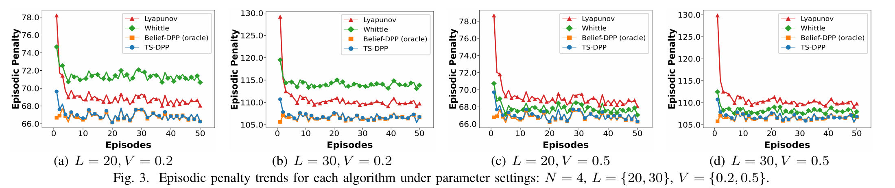
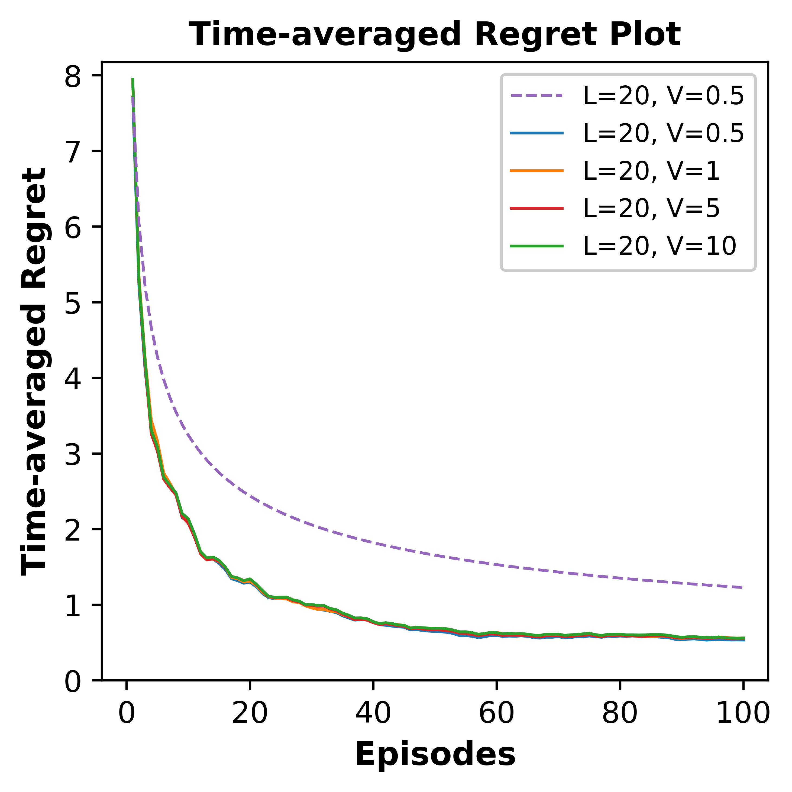
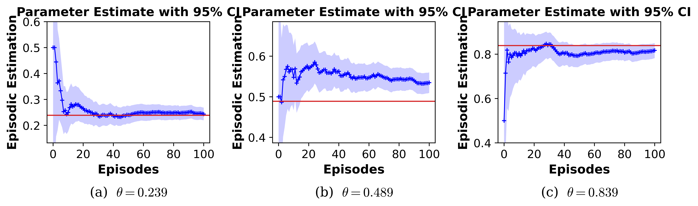

# Replica-TS-DPP: Theory under Scrutiny and Experiments Revisited

English | [中文](README.zh.md)

## Overview

```
@inproceedings{zhou2026age,
  title={Age-of-Information-Aware Mobile Crowdsensing for Uncertain Event Capture},
  author={Zhou, Jinrui and Xu, Yin and Xu, Haotian and Xiao, Mingjun and Wu, Jie},
  booktitle={IEEE INFOCOM 2026 - IEEE Conference on Computer Communications},
  pages={1--10},
  year={2026},
  organization={IEEE},
  doi={10.1109/INFOCOM59046.2026.11571737}
}
```

The [source](https://doi.org/10.1109/INFOCOM59046.2026.11571737) paper models uncertain event capture as a constrained episodic restless bandit with an unknown transition probability. It proposes *TS-DPP*, combining a belief drift-plus-penalty bandit policy with Thompson sampling.

This repo audits the paper's theoretical arguments and makes every effort to reproduce its experimental results. Our investigation reveals two main discrepancies:

1. Theory: The proof applies Lemma 5 outside its stated range. A simple counterexample also disproves the bound used in that step. See the [finding and counterexample](FINDING.md).
2. Experiments: Under our implementation with episode resets, Whittle achieves a lower episodic penalty than the oracle, reversing the ordering reported in the paper. See the [results and difference diagnostics](code/README.md#differences-from-the-paper).

## Replication results

| Source | Fig. 3 (`N = 4`) | Whittle penalty relative to the oracle |
| --- | --- | --- |
| [Paper](https://doi.org/10.1109/INFOCOM59046.2026.11571737) |  | Higher |
| This replica |  | Lower |

The replica uses the [stored simulation data](code/results/penalty_curves.csv). [Paper measurements](code/results/paper_levels.csv) and [implementation choices](code/README.md#difference-1) document the comparison.

Fig. 4: episodic penalty for each policy at `N = 8`.


Fig. 5: real-world trace replay.


Fig. 6: mean cumulative episode regret relative to the oracle.



Fig. 7: posterior means and Beta 95% credible intervals.



See the [Code README](code/README.md#differences-from-the-paper) for the eight differences and their explanations.

## Guide

| Topic | Where to start |
| --- | --- |
| Theory and formal verification | [cards/](cards/README.md) contains human-readable theorems, proofs, refutations, routes, and the dependency DAG; [lean4/](lean4/) contains the corresponding formalizations |
| Experiments and reproducibility | [code/](code/README.md) contains simulations, CSV data, figures, and diagnostics |
| Numerical exploration and auditing tools | [scripts/](scripts/README.md) contains numerical probes and repository checks; [lean4/scripts/](lean4/scripts/) contains build and axiom audit tools |
| Derivation history and correspondence with the paper | [DESIGN.md](DESIGN.md) records the development; [FIDELITY.md](FIDELITY.md) audits the correspondence to the paper |

## Acknowledgments

The proof workflow in [CLAUDE.md](CLAUDE.md) was inspired by an interview with Terence Tao about Lean-assisted mathematics.

Related discussions include his [Scientific American interview](https://www.scientificamerican.com/article/ai-will-become-mathematicians-co-pilot/) on dividing proofs into small tasks and recording failed attempts, and his [conversation with Lex Fridman](https://lexfridman.com/terence-tao-transcript/) on Lean blueprints and dependency graphs.
