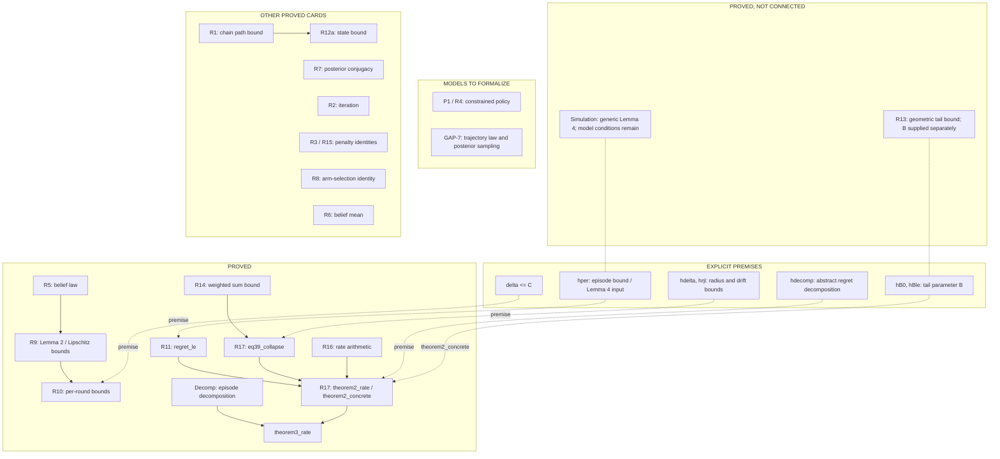
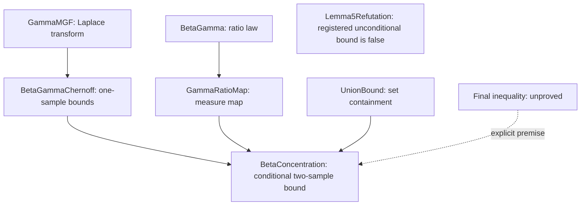

# Cards — theorem cards, proof cards, and the dependency DAG

English | [中文](README.zh.md)

Each card records a mathematical proposition, its proof or refutation route, and the results it depends on.

| Term or notation | Meaning |
| --- | --- |
| CLOSED | The listed statements have completed Lean proofs with no missing proof steps. |
| Explicit assumption | A condition given at the start of a proof; for example, a bound on each episode's regret used to derive a bound on total regret |
| Applying a general result (instantiation) | Specify how events occur and how data are sampled in this paper, then prove that they satisfy the conditions of the general result |
| NOT FORMALIZED | Not yet expressed as a Lean definition or theorem |
| REFUTED | A counterexample and its proof have been supplied |
| ROOT | The step deriving the final regret bound from the preceding lemmas, corresponding to R17 |
| [Telescoping sums](https://en.wikipedia.org/wiki/Telescoping_series) | Add consecutive differences so that the intermediate terms cancel $(a_1-a_0)+(a_2-a_1)+\cdots+(a_n-a_{n-1})=a_n-a_0.$ |

## Dependencies

The diagram shows how results depend on one another and where proofs or models remain to be supplied. Solid arrows show use of proved results, dashed arrows show required assumptions, and dotted lines show proved results awaiting application to this model.

## Results and remaining work

### Lemmas 3 and 4

The two results are at different stages:

| Lemma | Overall status | Proved | Remaining work |
| --- | --- | --- | --- |
| Lemma 3 | Incomplete | Finite summation by episodes, used in `theorem3_rate` | Supply the probability model, verify integration conditions, and derive the expectation decomposition |
| Lemma 4 | Incomplete | General summation identity | Supply the trajectory distribution and posterior sampling scheme, verify the lemma's conditions, and derive the required per-episode regret bound |

Proofs and remaining premises appear in [Theorem2.lean](../lean4/TSDPP/Theorem2.lean) and [Simulation.lean](../lean4/TSDPP/Simulation.lean).

### Lemma 5

| Target | Status | Completed | Remaining |
| --- | --- | --- | --- |
| Paper-stated range `0 ≤ r ≤ 1` | Formalization incomplete | A convex-order route and informal proof | Translate this proof into Lean; see [L5-CONVEX.md](L5-CONVEX.md) |
| Current conditional proof route | Conditional result proved | Auxiliary results yield a probability-bound expression | Prove that this expression is at most the target bound to obtain an unconditional result; see [L5.md](L5.md) |
| Bound used on `r ≥ 1` | Refuted | Counterexample and Lean refutation | —; see [L5-REFUTATION.md](L5-REFUTATION.md) |

The diagram shows the current conditional route; the dashed arrow marks the final inequality that remains to be proved.

### How the Lemma 5 constant affects the regret bound

Lemma 5 bounds the probability of estimation error. Its constant determines the error range used later: a weaker probability bound requires a larger permitted error to achieve the same confidence level.

The paper uses `1/8` in the probability bound and the corresponding `8` in the error range. This development's conditional route uses `11/100`, so the corresponding coefficient becomes its reciprocal, `100/11`. Calculations at this value yield a final regret-bound coefficient of `8`. These formulas share a constant, so changing its value requires updating the later calculations.

| Stage | Paper | This development |
| --- | --- | --- |
| Probability-bound constant | `1/8` | `11/100`, without a complete derivation |
| Corresponding error-range coefficient | `8` | `100/11` |
| Final regret-bound coefficient | See the paper's derivation | `8` in the proved conditional bound |

The geometric tail calculation is proved for any positive `c`, allowing different values. The conditional route still requires the final inequality before it can establish the probability-bound constant. See [R13.md](R13.md), [R16.md](R16.md), and [L5.md](L5.md) for the calculations.

### Content not yet expressed in Lean

[R4.md](R4.md) records the paper's DPP index, policy, and budget constraint (Eq (10), (12), and (13)); these are not yet expressed in Lean.

## Card index

| card | file | status |
|------|------|--------|
| R1  | `R1.md`  | CLOSED |
| R2  | `R2.md`  | CLOSED |
| R3  | `R3.md`  | CLOSED |
| R4  | `R4.md`  | **NOT FORMALIZED** — Eq (10),(12),(13); the constrained policy.  Out of scope, not an axiom |
| R5  | `R5.md`  | CLOSED |
| R6  | `R6.md`  | CLOSED |
| R7  | `R7.md`  | CLOSED |
| R8  | `R8.md`  | CLOSED |
| R9  | `R9.md`  | CLOSED |
| R10 | `R10.md` | CLOSED |
| R11 | `R11.md` | CLOSED |
| R12a| `R12a.md`| CLOSED |
| L34 | citation [28] | Combinatorial decomposition declarations CLOSED; generic simulation declarations CLOSED but not instantiated, leaving `hper` as an explicit premise. See GAP-7 |
| L5 | `L5.md`, `L5-REFUTATION.md` | Conditional declarations CLOSED with premise `hnum`; registered unconditional target on `r ≥ 1` REFUTED; refutation declarations CLOSED without additional premises. The paper-stated range `0 ≤ r ≤ 1` is not refuted |
| R13 | `R13.md` | Declarations CLOSED: tail bound parameterized by `c > 0`, not the printed Eq (40) |
| R14 | `R14.md` | CLOSED |
| R15 | `R15.md` | CLOSED |
| R16 | `R16.md` | Declarations CLOSED at `K₀ = 100/11`, with final constant `8` |
| R17 | `R17.md` | Declarations CLOSED; Combines the preceding lemmas into a conditional regret bound with the explicit premises in each signature |
