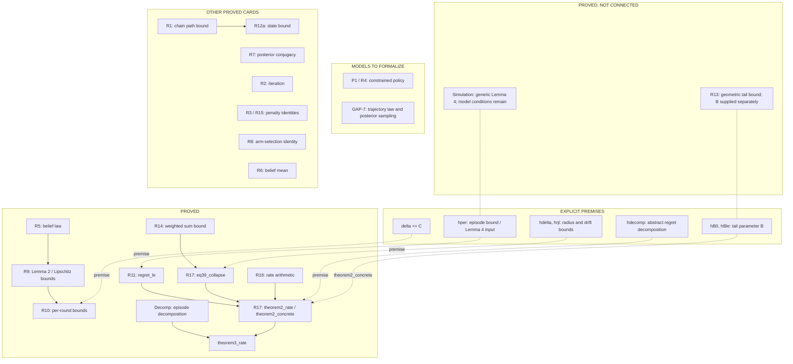
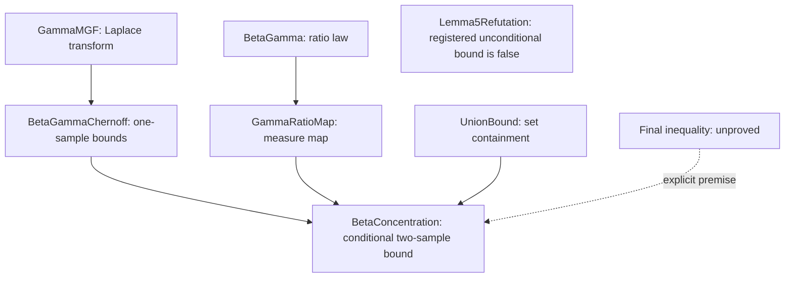

# Cards — 定理卡、证明卡与依赖 DAG

[English](README.md) | 中文

每张卡片记录一个数学命题、证明或反证思路及依赖关系。

| 名词 | 释义 |
| --- | --- |
| CLOSED | 所列数学陈述已完成 Lean 证明，证明无待补步骤。 |
| 显式假设 | 证明所需条件。例如，由每 episode 遗憾上界推导总遗憾上界 |
| 实例化 | 检查本论文中事件发生、数据采样是否满足通用结论所需条件，再应用该结论 |
| NOT FORMALIZED | 尚未写成 Lean 定义或定理 |
| REFUTED | 已找到反例，并给出证明 |
| ROOT | 由前述引理推出最终遗憾上界，对应 R17 |
| [望远镜求和](https://en.wikipedia.org/wiki/Telescoping_series) | 指将相邻差值相加，使中间项相消 $(a_1-a_0)+(a_2-a_1)+\cdots+(a_n-a_{n-1})=a_n-a_0.$ |

## 依赖关系

下图列出结论间依赖及待补证明、模型。*实线箭头*表示引用已证明结果，*虚线箭头*表示引入假设，*点线*表示已证明结果尚待应用于论文模型。

## 进展

### 引理 3 与引理 4

| 引理 | 状态 | 已证明项 | 待证明项 |
| --- | --- | --- | --- |
| 引理 3 | 尚未证毕 | 有限求和按 episode 分块，用于 `theorem3_rate` | 给出概率模型，验证积分条件，完成期望分解 |
| 引理 4 | 尚未证毕 | 一般求和关系 | 给出轨迹概率分布和后验采样方式，验证引理条件，得到论文所需每 episode 遗憾上界 |

证明与剩余前提见 [Theorem2.lean](../lean4/TSDPP/Theorem2.lean) 和 [Simulation.lean](../lean4/TSDPP/Simulation.lean)。

### 引理 5

| 内容 | 状态 | 已完成项 | 待完成项 |
| --- | --- | --- | --- |
| 论文原范围 `0 ≤ r ≤ 1` 内的命题 | 未完成形式化 | 已给出凸序证明思路及非形式化证明 | 将这条证明写成 Lean 证明；见 [L5-CONVEX.md](L5-CONVEX.md) |
| 当前条件证明路线 | 条件结论已证明 | 已由辅助结果推出概率上界表达式 | 还需证明该表达式不超过目标上界，才能得到无条件结论；见 [L5.md](L5.md) |
| 在 `r ≥ 1` 上使用的界 | 已反证 | 已给出反例及 Lean 反证 | —；见 [L5-REFUTATION.md](L5-REFUTATION.md) |

下图展示当前条件证明路线；虚线标出尚待证明的最后一个不等式。

### 引理 5 的常数如何影响遗憾上界

引理 5 用一个概率上界控制估计误差。这个界中的常数，决定后续计算采用多大的误差范围：概率界越弱，为达到同样的置信程度，就要允许更大的估计误差。

论文在概率界中采用 `1/8`，后续误差范围相应出现 `8`。本项目的条件证明路线采用 `11/100`，因此后续相应改用其倒数 `100/11`。沿这一取值计算，最终遗憾上界的系数为 `8`。这里的“相应”是前后公式共用同一个常数，改动一处，后续计算也须调整。

| 计算环节 | 论文取值 | 本项目取值 |
| --- | --- | --- |
| 概率界中的常数 | `1/8` | `11/100`，尚缺完整推导依据 |
| 误差范围中的对应系数 | `8` | `100/11` |
| 最终遗憾上界的系数 | 见论文推导 | 本项目证明的条件上界采用 `8` |

尾项计算已证明适用于任意正数 `c`；该结果可用于不同取值。现有条件证明仍需补齐最后一个不等式，才能据此确定概率界的常数。计算细节见 [R13.md](R13.md)、[R16.md](R16.md) 与 [L5.md](L5.md)。

### 尚未写入 Lean 的内容

[R4.md](R4.md) 记录论文的 DPP 指标、policy 与预算约束（Eq (10)、(12)、(13)）；这部分尚未写入 Lean。

## 卡片索引

| 卡片 | 文件 | 状态 |
|------|------|--------|
| R1  | `R1.md`  | CLOSED |
| R2  | `R2.md`  | CLOSED |
| R3  | `R3.md`  | CLOSED |
| R4  | `R4.md`  | **NOT FORMALIZED** — Eq (10),(12),(13)；受约束策略。超出范围，不是公理 |
| R5  | `R5.md`  | CLOSED |
| R6  | `R6.md`  | CLOSED |
| R7  | `R7.md`  | CLOSED |
| R8  | `R8.md`  | CLOSED |
| R9  | `R9.md`  | CLOSED |
| R10 | `R10.md` | CLOSED |
| R11 | `R11.md` | CLOSED |
| R12a| `R12a.md`| CLOSED |
| L34 | 文献 [28] | 组合分解声明 CLOSED；一般模拟引理声明 CLOSED，但尚未实例化，`hper` 仍为显式假设。见 GAP-7 |
| L5 | `L5.md`、`L5-REFUTATION.md` | 条件证明声明 CLOSED，仍要求 `hnum`；注册的 `r ≥ 1` 无条件目标已被反证；反证声明 CLOSED，不带额外假设。论文原陈述的 `0 ≤ r ≤ 1` 形式未被反证 |
| R13 | `R13.md` | 声明 CLOSED：尾项界以 `c > 0` 为参数，不等于证明论文印出的 Eq (40) |
| R14 | `R14.md` | CLOSED |
| R15 | `R15.md` | CLOSED |
| R16 | `R16.md` | 声明 CLOSED：采用 `K₀ = 100/11`，最终常数为 `8` |
| R17 | `R17.md` | 声明 CLOSED；由前述引理推出条件遗憾上界，仍保留各声明列出的显式前提 |
